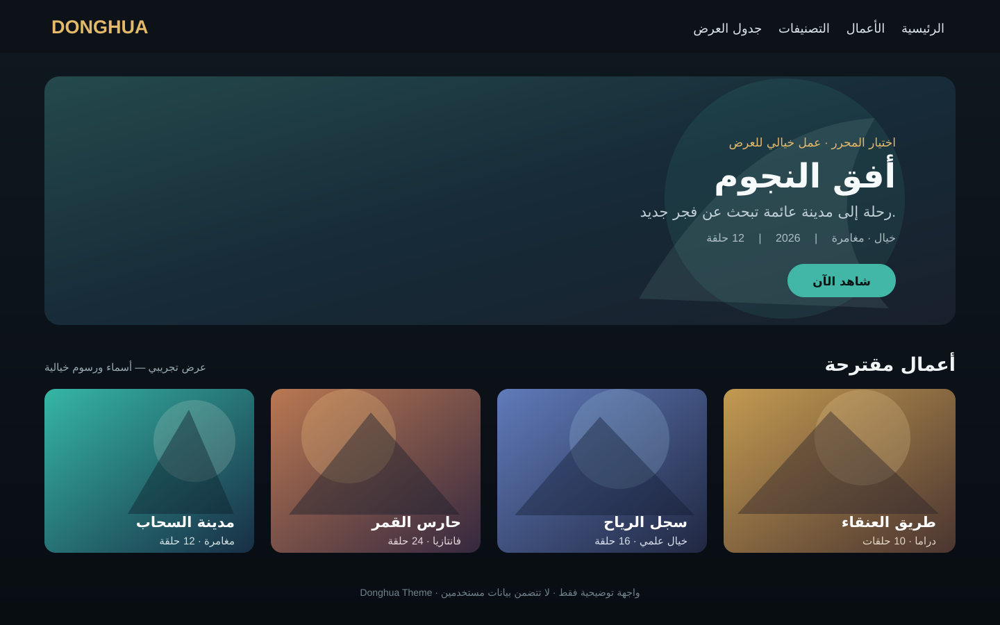
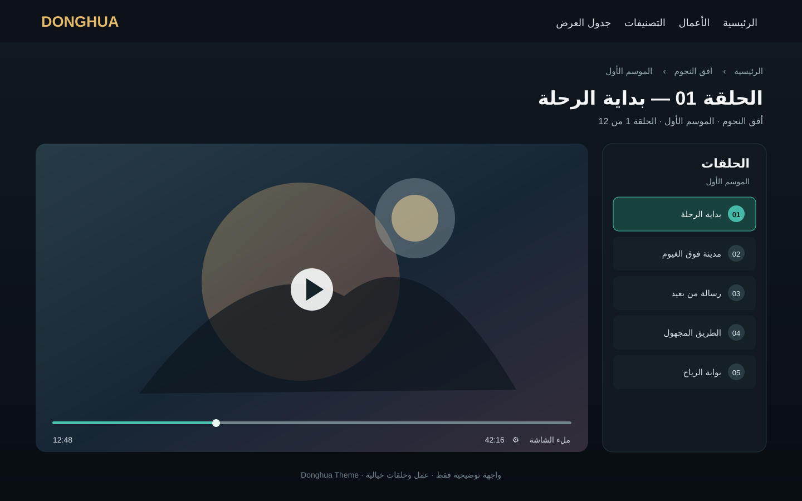

# Donghua Theme

**قالب WordPress عربي متجاوب لمواقع الدونغهوا.** يشمل صفحات الأعمال والحلقات والأفلام والتصنيفات والمشاهدة.

> صور المعاينة أدناه نماذج توضيحية برسوم وأسماء خيالية. لا تحتوي صورًا أو بيانات من حسابات أو مواقع فعلية.

## معاينة القالب

### الصفحة الرئيسية والأعمال

### صفحة الحلقة وقائمة الحلقات

## المتطلبات

- WordPress 6.0 أو أحدث. اختبر الإصدار المستهدف على staging قبل الإنتاج.
- PHP 8.1 أو أحدث.
- إضافة **Donghua Core** مطلوبة لأنها توفر أنواع المحتوى والحقول وواجهات البيانات التي يعتمد عليها القالب.
- إضافة **Donghua Monetization** مطلوبة لميزات العضويات والاستحقاقات والشارات والتحكم بالموقع. بعض الأجزاء تتحقق من وجودها وتخفي وظائفها عند غيابها؛ التجربة الكاملة تحتاج الإضافتين.

هذه حزمة قالب فقط. لا تتضمن WordPress أو الإضافات أو قاعدة بيانات أو محتوى الموقع أو ملفات الوسائط. لا تعتمد على منصة فيديو خاصة؛ مصادر المشاهدة تدار من حقول WordPress وإضافة التشغيل المتوافقة.

## التثبيت من لوحة WordPress

1. نزّل ZIP من GitHub أو أنشئه من مجلد القالب بحيث يحتوي ZIP على مجلد `donghua-theme` في المستوى الأعلى.
2. افتح **المظهر ← قوالب ← أضف قالبًا ← رفع قالب**، ثم ارفع الملف وثبّته وفعّله.
3. ثبّت وفعّل إضافتي Donghua Core وDonghua Monetization من مصدريهما المصرّح بهما.
4. خذ نسخة احتياطية واختبر على staging. إذا لم تظهر أنواع المحتوى، راجع إعدادات الروابط الدائمة واحفظها.

## GitHub

يمكن رفع محتويات هذا المجلد إلى مستودع GitHub مستقل. مجلد `docs/previews/` مخصص لصور العرض ولا يغير تصميم القالب. لا ترفع ملفات WordPress الأساسية، أو `wp-config.php`، أو كلمات المرور ومفاتيح API، أو قاعدة البيانات، أو ملفات الوسائط. أنشئ إصدار GitHub عند اعتماد نسخة القالب، ثم ارفع ZIP القابل للتثبيت.

## التوافق والتخصيص

- نطاق الترجمة هو `donghua-theme` ومجلد الترجمة `languages`.
- ملفات الواجهات والأنماط والبرامج النصية موزعة ضمن `template-parts/` و`inc/` و`assets/`.
- أنواع المحتوى والحقول تأتي من الإضافات المذكورة. القالب وحده لا يستورد بيانات الموقع ولا يضمن توافق إضافات تشغيل خارجية غير موثقة.
- بعد التثبيت اختبر صفحة العمل والحلقة والفيلم والبحث وتسجيل الدخول والتصميم على الهاتف.

## الأمان والخصوصية

لا تضع أسرارًا في ملفات القالب أو المستودع. حماية الوسائط الخاصة يجب أن ينفذها خادم أو إضافة تتحقق من صلاحية المشاهد؛ إخفاء رابط المشغل وحده لا يوفر حماية.

## الإصدار والترخيص

الإصدار **3.0.27**. الترخيص المعلن في ترويسة القالب هو GNU GPL v2 or later؛ راجع `LICENSE.txt`.
